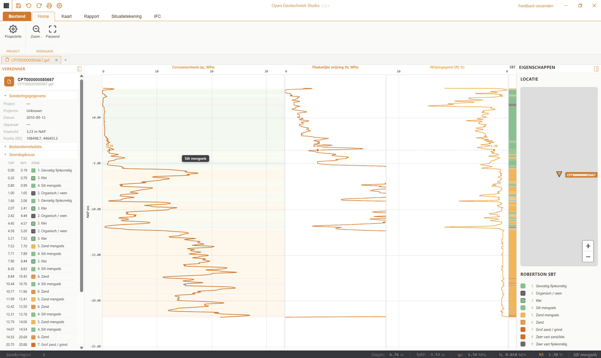
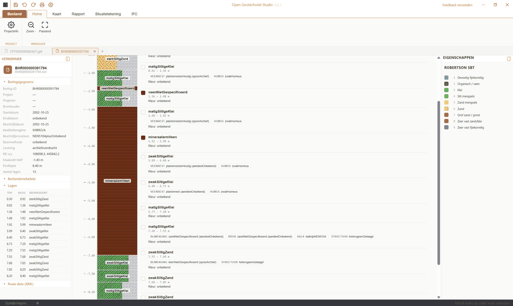
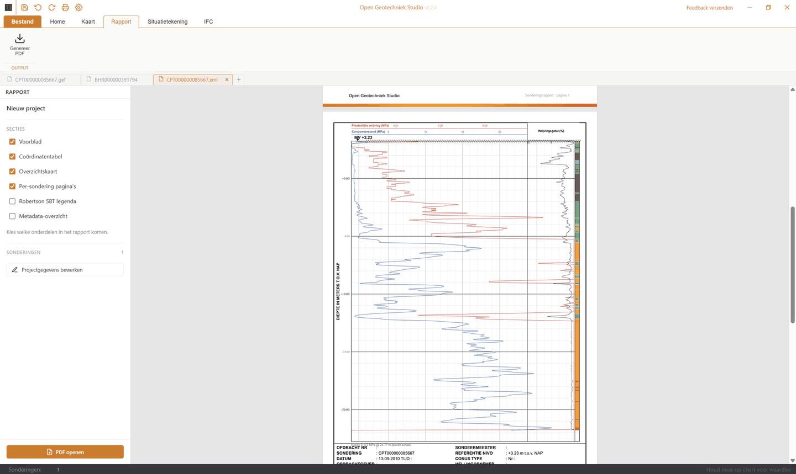
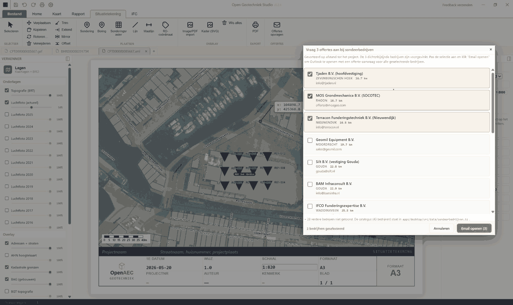
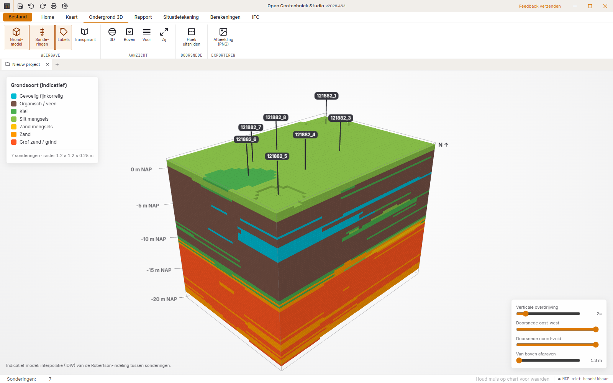
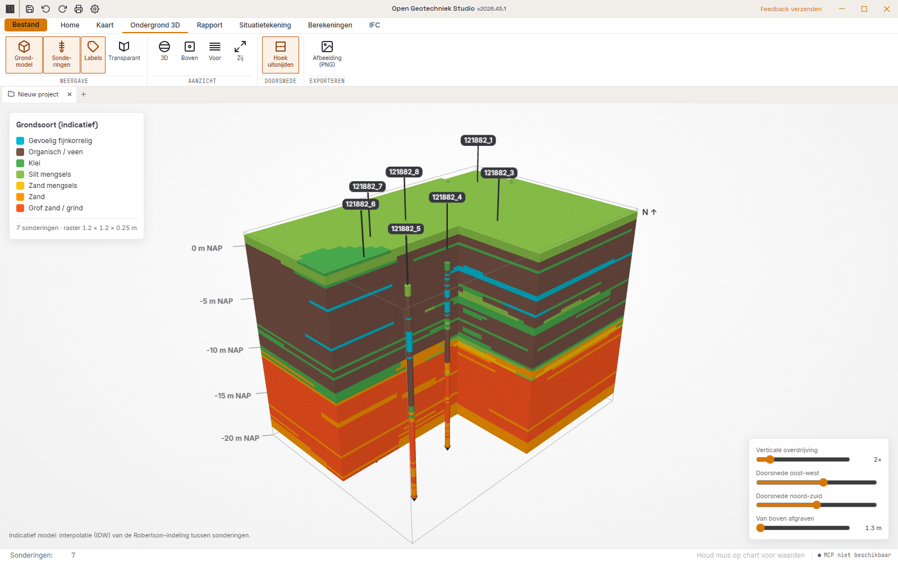

**English** · [Nederlands](README.nl.md)

<div align="center">

# Open Geotechniek Studio

**Read Dutch CPTs and boreholes, place them on the map and the site plan, and turn them into reports and pile calculations you can check line by line.**

[](https://github.com/OpenAEC-Foundation/open-geotechniek-studio/releases/latest)
[](https://github.com/OpenAEC-Foundation/open-geotechniek-studio/actions/workflows/ci.yml)
[](#license)


### [Download](https://github.com/OpenAEC-Foundation/open-geotechniek-studio/releases/latest)



</div>

Open Geotechniek Studio is a desktop app for geotechnical engineers and consultants in the Netherlands. It reads CPTs (GEF and BRO-XML) and boreholes (BRO BHR-GT), fetches them from the national subsurface register on a map, places them on a site plan, and produces PDF reports and concept pile calculations.

It runs as a desktop app on Windows, macOS and Linux.

## Try it

[Download the installer](https://github.com/OpenAEC-Foundation/open-geotechniek-studio/releases/latest) for your platform and start the app. Open a `.gef` or BRO `.xml` file, or go to **Map** and choose **Load area** to fetch every CPT and borehole around you from the BRO.

## Download

Every release is on the [releases page](https://github.com/OpenAEC-Foundation/open-geotechniek-studio/releases/latest).

| Platform | Installer |
|----------|-----------|
| **Windows** | `.exe` installer (x64, NSIS) |
| **macOS** | `.dmg` (universal: Apple silicon and Intel) |
| **Linux** | `.deb`, `.AppImage` (x64) |

There is no built-in updater yet: install a new version over the old one. Your projects are ordinary files and stay where they are. Every file is signed: Windows with Authenticode and a timestamp, macOS with a Developer ID and notarized by Apple, Linux with the OpenAEC OpenPGP key and a build attestation. `SHA256SUMS.txt` lists the checksum of every file.

## Why use it?

- **Free and open.** MIT licence. No licence fees, no account, no lock-in.
- **Open formats.** GEF and BRO-XML in, GEF, CSV and GeoJSON out; a whole project is one `.ifcgeo` file (IFCX JSON) that you can read yourself.
- **BRO and PDOK on the map.** Load the CPTs and boreholes in an area with one click, on aerial photos, buildings, parcels and elevation.
- **Reports you can hand over.** Cover, coordinate table, overview map and one page per CPT, in the OpenAEC house style.
- **Calculations you can check.** Every pile calculation shows its formula, the filled-in values and the outcome, next to the input.
- **Verified where it counts.** The lateral pile kernel matches closed-form solutions and an independent solver to within 0.005 %.
- **Works with an AI assistant.** An MCP server controls the open window on your own computer.

## Screenshots

| | |
|---|---|
|  **A CPT with indicative soil zones** |  **A BRO borehole with its soil layers** |
|  **The PDF CPT report** |  **A site plan with a CPT grid** |
|  **A 3D soil model from the CPTs** |  **The 3D model with a corner cut away** |

The screenshots show the Dutch interface.

## CPTs and boreholes

- **GEF 1.x and BRO-XML.** CPT_O and CPT_O_DP, and boreholes from BHR-GT. Import messages stay with the project and can be exported as CSV or JSON.
- **The CPT chart.** Cone resistance qc, sleeve friction fs, friction ratio Rf and pore pressure u2 against depth in m NAP, with indicative qc/Rf soil zones. The zones are indicative; they are not a normalised classification.
- **Many CPTs side by side.** Scale the columns with the zoom, or fit them to the window.

## Map and site plan

- **Map.** PDOK background maps, aerial photos 2016–2025, BAG buildings, cadastral parcels, zoning plans, BGT and elevation, with a live measuring tool. Load the BRO CPTs and boreholes in the visible area.
- **Site plan.** A fixed A2 or A3 sheet at a true scale, with CPT markers, a CPT grid, dimension lines, RD coordinate tags, overlays from PDF or images, snapping to buildings and parcels, and a title block.

## Pile calculations

The calculations are **concept**: they show every step but do not replace a checked design.

- **Bearing capacity of a single pile.** Steel, concrete and timber piles, including timber with a concrete extension. The sheet shows the input and the CPT next to the worked-out output, with a print preview and PDF.
- **Capacity table.** Rc;net;d per CPT for a range of pile sizes and toe levels. Enter the capacity you need, such as 500–1000 kN, and see per size the shortest pile that reaches it and how much the toe level varies between CPTs. The report takes a few worked examples followed by the tables.
- **Laterally loaded pile.** A beam on linear or non-linear soil springs, with layer correction. The input is a drawing of the section with its reinforcement and levels in m NAP. The output has the diagrams of displacement, moment (on the tension side) and shear, the soil reaction per layer, the N–M interaction and a PDF report. See the [verification](apps/desktop/src/calc/modules/laterally-loaded-pile/VERIFICATIE.md).
- **Settings per calculation.** Pile factors (table or project value), standard size series, subgrade values and pu profiles per soil type.

The supported pile systems and their limits are in [PAALSOORTEN.md](apps/desktop/src/calc/modules/pile-bearing-capacity/PAALSOORTEN.md) and [HISTORISCHE-NORMEN.md](apps/desktop/src/calc/modules/pile-bearing-capacity/HISTORISCHE-NORMEN.md).

## Interoperability

| Format | Open | Save / export |
|--------|------|---------------|
| **GEF** (`.gef`) | Yes | Yes, GEF-CPT 1.1.2 |
| **BRO-XML** CPT and BHR-GT | Yes | No |
| **Project** (`.ifcgeo`, IFCX JSON) | Yes | Yes |
| **IFCX** | Yes | Yes, experimental snapshot |
| **IFC4x3** (STEP) | Yes, to inspect | No: the old export was not schema-valid and is switched off |
| **CSV**, **GeoJSON** | No | Yes |
| **PDF** | No | Yes: CPT report, site plan, pile reports |

A project file keeps the CPTs, the import messages, the site plan and the calculations. Older `.ifcgis` and `.ifcx` projects still open.

## MCP

The desktop app has an MCP server for an AI assistant. `open-geo-studio --mcp-studio` controls the open Studio window: open files, edit project data, add and change pile calculations, read the capacity table, open a view and write a PDF report. A status indicator in the bottom right shows when a client is connected and what it is doing. The server runs only on your own computer, uses absolute file paths and never opens a file dialog. `open-geo-studio --mcp` runs a separate headless mode. See [docs/API.md](docs/API.md).

## Testing and reliability

- **707 unit and component tests in 86 files** in `apps/desktop/src`, run with Vitest on every pull request and push to `main`.
- **35 comparisons for the lateral pile kernel** against closed-form solutions (Hetényi, Matlock & Reese) and an independent finite-difference solver, in `verification.test.ts`.
- **Bearing capacity regression** against an external reference calculation (`984.pdf`) and 100 public reference cases, in the `verification-984*` and `public-reference` tests.
- **Release checks**: synchronised versions, Blueprint assets, signatures of every installer and the native SDK on Windows, macOS and Linux.

Count sources: `npx vitest run` in `apps/desktop` on `main`, and the files named above.

## Current limitations

- **The calculations are concept.** They are indicative and carry a concept mark on screen and in every PDF.
- **The lateral pile has no standard p-y curves for clay and sand.** It uses linear springs or a hyperbolic project law; the published reference cases that need those curves are listed but not yet compared.
- **The calculation modules and their reports are in Dutch only.** The rest of the interface is available in ten languages.
- **No updater.** Install a new version over the old one.
- **IFC4x3 export is switched off.** Use the IFCX snapshot until a schema-valid export is back.

Found something? [Open an issue](https://github.com/OpenAEC-Foundation/open-geotechniek-studio/issues).

## Under the hood

A Tauri 2 desktop app with a React and TypeScript interface; the CPT parsers, plots and native reports are Rust crates from [crates-warehouse](https://github.com/OpenAEC-Foundation/crates-warehouse). The same GEF/BRO parser also runs as a headless [Node core with HTTP API and MCP](packages/core/README.md) and a [native C ABI SDK](packages/native/README.md); see the [capability matrix](docs/READINESS.md). The shared look, fonts and icons come from [OpenAEC Blueprint](https://github.com/OpenAEC-Foundation/OpenAEC-Blueprint); the pinned source commit is in `apps/desktop/src/styles/blueprint/SOURCE.json`.

## Contributing

- **Try it on a real project** and report bugs or missing features as an [issue](https://github.com/OpenAEC-Foundation/open-geotechniek-studio/issues/new). Describe what you did, what you expected and what happened. The feedback button in the app opens an issue for you.
- **Share test files.** GEF and BRO files that read wrongly are the most useful bug reports.
- **Write code.** Open an issue first for a larger change, then a pull request. Interface changes follow [OpenAEC Blueprint](https://github.com/OpenAEC-Foundation/OpenAEC-Blueprint).

## Quick start (developers)

```bash
git clone https://github.com/OpenAEC-Foundation/crates-warehouse.git
git clone https://github.com/OpenAEC-Foundation/open-geotechniek-studio.git
cd open-geotechniek-studio/apps/desktop
npm ci
npm run tauri dev
```

Requires Node.js 22, Rust stable and the [Tauri 2 prerequisites](https://v2.tauri.app/start/prerequisites/) for your platform. `crates-warehouse` must sit next to this repository. `npm test` runs the tests; `python scripts/build_readme_images.py --check` checks the README images.

Versions follow the OpenAEC scheme `YYYY.W.N`: year, ISO week without a leading zero, and a number within the week that starts at 0, such as `2026.45.5`. `python scripts/version.py --next` sets the next version; a tag `vYYYY.W.N` starts the signed release. See [docs/RELEASE.md](docs/RELEASE.md) for signing and candidate builds.

Open Geotechniek Studio is part of the [OpenAEC Foundation](https://github.com/OpenAEC-Foundation) family of apps. CPT and borehole data come from [BRO](https://basisregistratieondergrond.nl/) and the map layers from [PDOK](https://www.pdok.nl/).

## License

MIT. See [LICENSE](LICENSE).

## Trademarks

Windows, macOS and other names of operating systems and services are trademarks of their owners. Open Geotechniek Studio is an independent project and is not affiliated with, endorsed by or sponsored by them.
