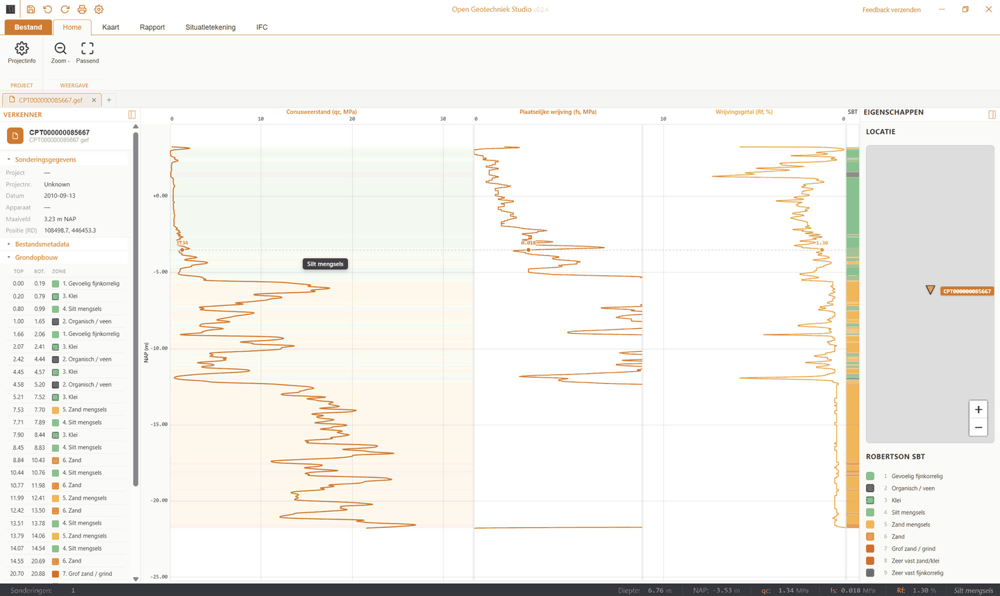
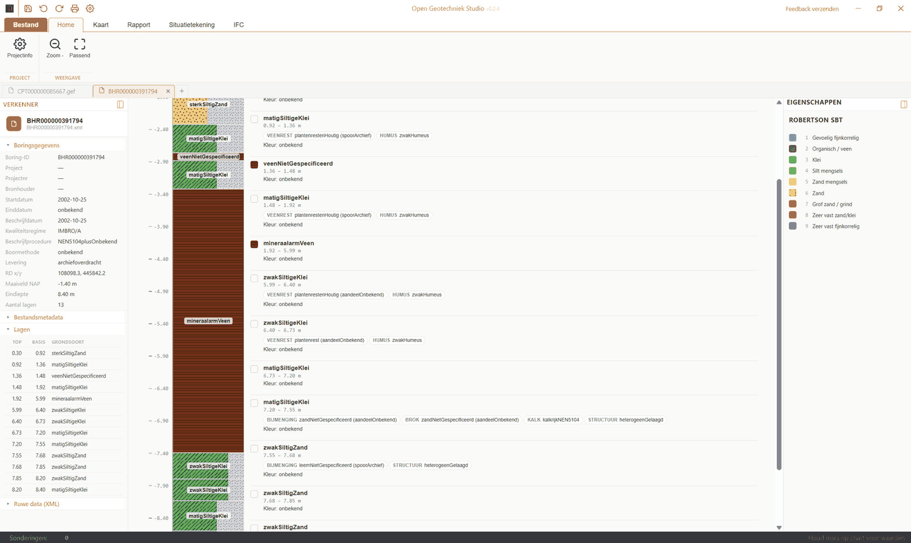
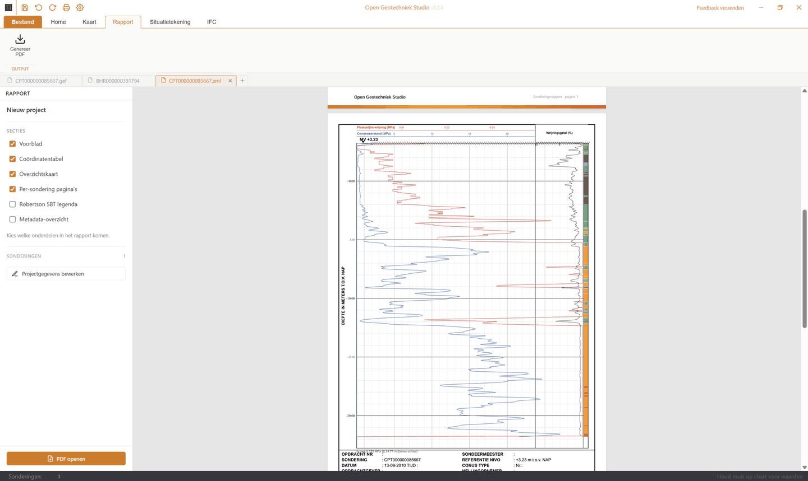
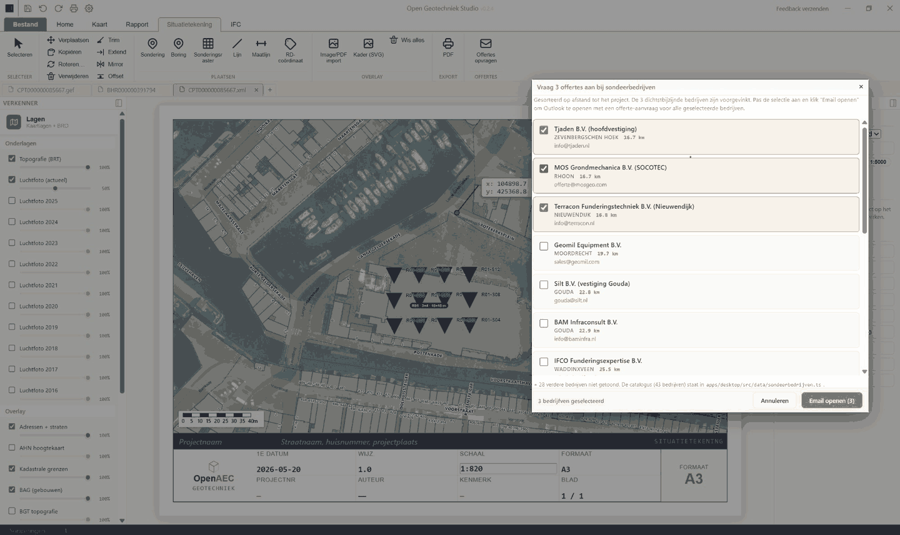
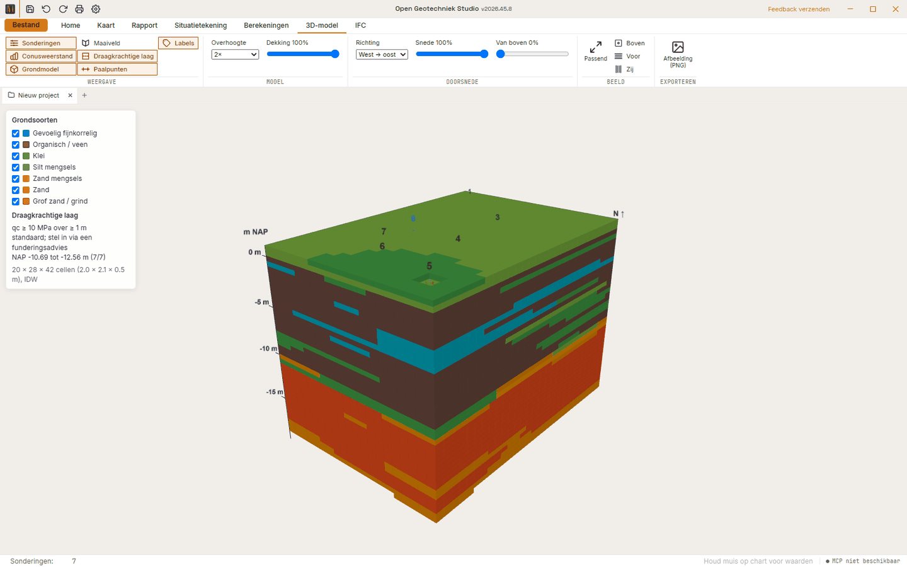
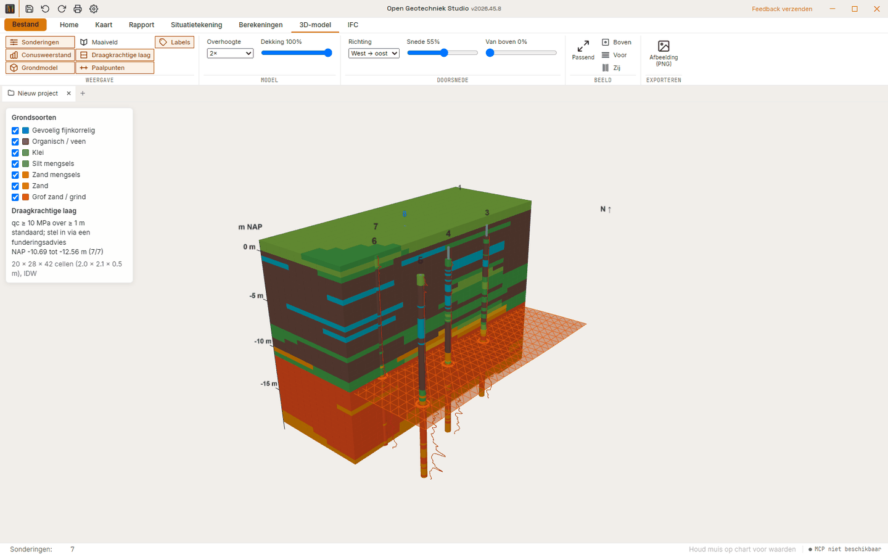
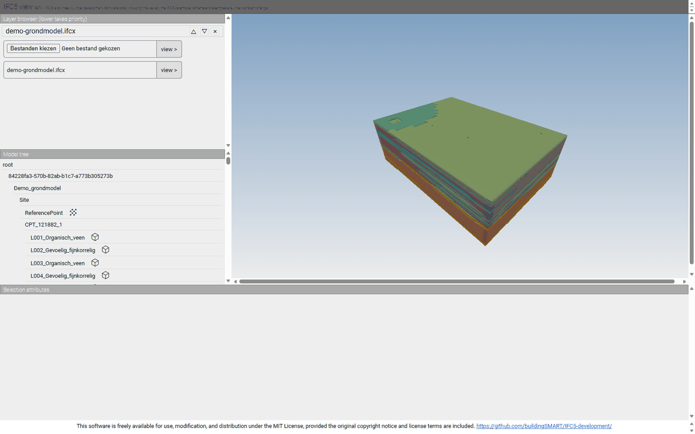

[English](README.md) · **Nederlands**

<div align="center">

# Open Geotechniek Studio

**Lees Nederlandse sonderingen en boringen, zet ze op de kaart en de situatietekening, en maak er rapporten en paalberekeningen van die je regel voor regel kunt nalopen.**

[](https://github.com/OpenAEC-Foundation/open-geotechniek-studio/releases/latest)
[](https://github.com/OpenAEC-Foundation/open-geotechniek-studio/actions/workflows/ci.yml)
[](#licentie)


### [Download](https://github.com/OpenAEC-Foundation/open-geotechniek-studio/releases/latest)



</div>

Open Geotechniek Studio is een desktopapp voor geotechnisch ingenieurs en adviseurs in Nederland. Je leest er sonderingen (GEF en BRO-XML) en boringen (BRO BHR-GT) mee in, haalt ze op een kaart op uit de Basisregistratie Ondergrond, zet ze op een situatietekening en maakt er PDF-rapporten en conceptberekeningen voor palen van.

De app draait op Windows, macOS en Linux.

## Probeer het

[Download de installer](https://github.com/OpenAEC-Foundation/open-geotechniek-studio/releases/latest) voor je platform en start de app. Open een `.gef`- of BRO-`.xml`-bestand, of ga naar **Kaart** en kies **Laad gebied** om alle sonderingen en boringen in de buurt uit de BRO op te halen.

## Download

Elke release staat op de [releasepagina](https://github.com/OpenAEC-Foundation/open-geotechniek-studio/releases/latest).

| Platform | Installer |
|----------|-----------|
| **Windows** | `.exe`-installer (x64, NSIS) |
| **macOS** | `.dmg` (universeel: Apple silicon en Intel) |
| **Linux** | `.deb`, `.AppImage` (x64) |

Er is nog geen ingebouwde updater: installeer een nieuwe versie over de oude heen. Je projecten zijn gewone bestanden en blijven staan waar ze staan. Elk bestand is ondertekend: Windows met Authenticode en een tijdstempel, macOS met een Developer ID en door Apple genotariseerd, Linux met de OpenPGP-sleutel van OpenAEC en een buildattestatie. `SHA256SUMS.txt` bevat de controlesom van elk bestand.

## Waarom deze app?

- **Vrij en open.** MIT-licentie. Geen licentiekosten, geen account, geen lock-in.
- **Open formaten.** GEF en BRO-XML erin, GEF, CSV en GeoJSON eruit; een heel project is één `.ifcgeo`-bestand (IFCX JSON) dat je zelf kunt lezen.
- **BRO en PDOK op de kaart.** Laad met één klik de sonderingen en boringen in een gebied, op luchtfoto's, gebouwen, percelen en hoogtes.
- **Rapporten die je kunt overdragen.** Voorblad, coördinatentabel, overzichtskaart en een pagina per sondering, in de huisstijl van OpenAEC.
- **Berekeningen die je kunt nalopen.** Elke paalberekening toont de formule, de ingevulde waarden en de uitkomst, naast de invoer.
- **Geverifieerd waar het telt.** De rekenkern van de horizontale paal komt binnen 0,005 % overeen met gesloten oplossingen en een onafhankelijke rekenmethode.
- **Werkt met een AI-assistent.** Een MCP-server bedient het geopende venster op je eigen computer.

## Schermafbeeldingen

| | |
|---|---|
|  **Een sondering met indicatieve grondzones** |  **Een BRO-boring met grondlagen** |
|  **Het PDF-sonderingsrapport** |  **Een situatietekening met sonderingsraster** |
|  **Een 3D-grondmodel uit de sonderingen** |  **Het 3D-model opengesneden bij de sonderingen** |

## Sonderingen en boringen

- **GEF 1.x en BRO-XML.** CPT_O en CPT_O_DP, en boringen uit BHR-GT. Importmeldingen blijven bij het project en zijn als CSV of JSON te exporteren.
- **De sonderingsgrafiek.** Conusweerstand qc, plaatselijke wrijving fs, wrijvingsgetal Rf en waterspanning u2 tegen de diepte in m NAP, met indicatieve qc/Rf-grondzones. De zones zijn indicatief; het is geen genormaliseerde classificatie.
- **Meerdere sonderingen naast elkaar.** Schaal de kolommen mee met de zoom, of laat ze in het venster passen.

## Kaart en situatietekening

- **Kaart.** PDOK-achtergrondkaarten, luchtfoto's 2016–2025, BAG-gebouwen, kadastrale percelen, bestemmingsplannen, BGT en hoogtes, met een meetlat. Laad de BRO-sonderingen en -boringen in het zichtbare gebied.
- **Situatietekening.** Een vast A2- of A3-blad op ware schaal, met sonderingsmarkeringen, een sonderingsraster, maatlijnen, RD-coördinaten, onderleggers uit PDF of afbeeldingen, snappen op gebouwen en percelen, en een titelbalk.

## 3D-grondmodel

- **Opgebouwd uit de sonderingen.** Elke sondering met RD-coördinaten wordt een kolom in haar laagkleuren, met de conusweerstand ernaast. Tussen de sonderingen wordt de grondsoort per cel geïnterpoleerd met inverse-afstandsweging. Het model is indicatief: tussen sonderingen is de laagopbouw een aanname.
- **Draagkrachtige laag en paalpunten.** De bovenkant van de draagkrachtige laag per sondering, als geïnterpoleerd vlak, en de paalpuntniveaus uit de paalberekeningen.
- **Erin kijken.** Overhoogte, dekking, een doorsnede langs beide assen, afgraven van boven en grondsoorten aan en uit.
- **Aanzichten en export.** 3D, boven, voor en zij, en het beeld als PNG.

## IFC5-export (IFCX)

- **Het hele grondonderzoek in één open bestand.** Via het IFC-tabblad of het 3D-model exporteer je het project als IFC5 (IFCX alpha), het JSON-formaat van de volgende IFC-generatie, volgens de geotechnische voorbeelden van buildingSMART.
- **Sonderingen** als `IfcBorehole` met metadata, de volledige reeksen qc, fs, Rf en u2 en de laagindeling, elke laag in de kleur van de grondsoort.
- **3D-grondmodel** als `IfcGeomodel` met per grondsoort een `IfcGeotechnicalStratum`, gekoppeld aan de lagen in de sonderingen waarop het rust, plus de bovenkant van de draagkrachtige laag en de palen uit de paalberekeningen.
- **Gegeorefereerd** in RD (EPSG:28992), NAP (EPSG:5709) en WGS84, zodat een openBIM-platform het op de kaart zet.



## Paalberekeningen

De berekeningen zijn **concept**: ze tonen elke stap, maar vervangen geen gecontroleerd ontwerp.

- **Draagvermogen van een enkele paal.** Stalen, betonnen en houten palen, ook hout met een betonopzetter. Het rekenblad toont de invoer en de sondering naast de uitgewerkte uitdraai, met afdrukvoorbeeld en PDF.
- **Draagvermogentabel.** Rc;net;d per sondering voor een reeks paalmaten en puntniveaus. Geef het gezochte draagvermogen op, bijvoorbeeld 500–1000 kN, en zie per maat de kortste paal die het haalt en hoeveel het puntniveau tussen de sonderingen varieert. Het rapport bevat een paar uitgewerkte voorbeelden en daarna de tabellen.
- **Horizontaal belaste paal.** Een ligger op lineaire of niet-lineaire grondveren, met laagcorrectie. De invoer is een tekening van de doorsnede met de wapening en niveaus in m NAP. De uitdraai bevat de lijnen van verplaatsing, moment (aan de getrokken zijde) en dwarskracht, de grondreactie per laag, de N–M-interactie en een PDF-rapport. Zie de [verificatie](apps/desktop/src/calc/modules/laterally-loaded-pile/VERIFICATIE.md).
- **Instellingen per berekening.** Paalfactoren (tabel- of projectwaarde), standaard maatreeksen, beddingswaarden en pu-profielen per grondsoort.

De ondersteunde paalsystemen en hun grenzen staan in [PAALSOORTEN.md](apps/desktop/src/calc/modules/pile-bearing-capacity/PAALSOORTEN.md) en [HISTORISCHE-NORMEN.md](apps/desktop/src/calc/modules/pile-bearing-capacity/HISTORISCHE-NORMEN.md).

## Uitwisseling

| Formaat | Openen | Opslaan / exporteren |
|---------|--------|----------------------|
| **GEF** (`.gef`) | Ja | Ja, GEF-CPT 1.1.2 |
| **BRO-XML** sondering en BHR-GT | Ja | Nee |
| **Project** (`.ifcgeo`, IFCX JSON) | Ja | Ja |
| **IFCX** | Ja | Ja, experimentele momentopname |
| **IFC4x3** (STEP) | Ja, om te bekijken | Nee: de oude export was niet schema-geldig en staat uit |
| **CSV**, **GeoJSON** | Nee | Ja |
| **PDF** | Nee | Ja: sonderingsrapport, situatietekening, paalrapporten |

Een projectbestand bewaart de sonderingen, de importmeldingen, de situatietekening en de berekeningen. Oudere `.ifcgis`- en `.ifcx`-projecten blijven te openen.

## MCP

De desktopapp heeft een MCP-server voor een AI-assistent. `open-geo-studio --mcp-studio` bedient het geopende Studio-venster: bestanden openen, projectgegevens wijzigen, paalberekeningen toevoegen en aanpassen, de draagvermogentabel lezen, een weergave openen en een PDF-rapport wegschrijven. Een indicator rechtsonder toont wanneer een client verbonden is en wat hij doet. De server draait alleen op je eigen computer, werkt met absolute paden en opent nooit een bestandsdialoog. `open-geo-studio --mcp` start een aparte modus zonder venster. Zie [docs/API.md](docs/API.md).

## Testen en betrouwbaarheid

- **707 unit- en componenttests in 86 bestanden** in `apps/desktop/src`, met Vitest bij elke pull request en elke push naar `main`.
- **35 vergelijkingen voor de rekenkern van de horizontale paal** met gesloten oplossingen (Hetényi, Matlock & Reese) en een onafhankelijke differentieoplossing, in `verification.test.ts`.
- **Regressie van het draagvermogen** tegen een externe referentieberekening (`984.pdf`) en 100 openbare referentiegevallen, in de tests `verification-984*` en `public-reference`.
- **Releasecontroles**: gelijke versienummers, Blueprint-bestanden, handtekeningen van elke installer en de native SDK op Windows, macOS en Linux.

Bron van de tellingen: `npx vitest run` in `apps/desktop` op `main`, en de genoemde bestanden.

## Huidige beperkingen

- **De berekeningen zijn concept.** Ze zijn indicatief en dragen een conceptmarkering op het scherm en in elke PDF.
- **De horizontale paal heeft geen standaard p-y-krommen voor klei en zand.** Hij rekent met lineaire veren of een hyperbolische projectwet; de gepubliceerde referentiegevallen die die krommen nodig hebben, staan op een lijst maar zijn nog niet vergeleken.
- **De rekenmodules en hun rapporten zijn alleen Nederlandstalig.** De rest van de interface is in tien talen beschikbaar.
- **Geen updater.** Installeer een nieuwe versie over de oude heen.
- **De IFC4x3-export staat uit.** Gebruik de IFCX-momentopname tot er weer een schema-geldige export is.

Iets gevonden? [Maak een issue aan](https://github.com/OpenAEC-Foundation/open-geotechniek-studio/issues).

## Onder de motorkap

Een Tauri 2-desktopapp met een interface in React en TypeScript; de sonderingsparsers, grafieken en native rapporten zijn Rust-crates uit [crates-warehouse](https://github.com/OpenAEC-Foundation/crates-warehouse). Dezelfde GEF/BRO-parser draait ook als headless [Node-core met HTTP-API en MCP](packages/core/README.md) en als [native SDK met C ABI](packages/native/README.md); zie de [capabilitymatrix](docs/READINESS.md). Het uiterlijk, de lettertypen en de iconen komen uit [OpenAEC Blueprint](https://github.com/OpenAEC-Foundation/OpenAEC-Blueprint); de vastgelegde broncommit staat in `apps/desktop/src/styles/blueprint/SOURCE.json`.

## Bijdragen

- **Probeer het op een echt project** en meld fouten of ontbrekende functies als [issue](https://github.com/OpenAEC-Foundation/open-geotechniek-studio/issues/new). Beschrijf wat je deed, wat je verwachtte en wat er gebeurde. De feedbackknop in de app maakt het issue voor je aan.
- **Deel testbestanden.** GEF- en BRO-bestanden die verkeerd worden ingelezen, zijn de nuttigste foutmeldingen.
- **Schrijf code.** Open eerst een issue voor een grotere wijziging, daarna een pull request. Wijzigingen aan de interface volgen [OpenAEC Blueprint](https://github.com/OpenAEC-Foundation/OpenAEC-Blueprint).

## Snel aan de slag (ontwikkelaars)

```bash
git clone https://github.com/OpenAEC-Foundation/crates-warehouse.git
git clone https://github.com/OpenAEC-Foundation/open-geotechniek-studio.git
cd open-geotechniek-studio/apps/desktop
npm ci
npm run tauri dev
```

Vereist Node.js 22, Rust stable en de [Tauri 2-vereisten](https://v2.tauri.app/start/prerequisites/) voor je platform. `crates-warehouse` moet naast deze repository staan. `npm test` draait de tests; `python scripts/build_readme_images.py --check` controleert de README-beelden.

Versienummers volgen het OpenAEC-schema `JJJJ.W.N`: jaar, ISO-week zonder voorloopnul en een volgnummer binnen de week dat bij 0 begint, zoals `2026.45.5`. `python scripts/version.py --next` zet de volgende versie; een tag `vJJJJ.W.N` start de ondertekende release. Zie [docs/RELEASE.md](docs/RELEASE.md) voor ondertekening en testbuilds.

Open Geotechniek Studio hoort bij de apps van de [OpenAEC Foundation](https://github.com/OpenAEC-Foundation). Sonderingen en boringen komen uit de [BRO](https://basisregistratieondergrond.nl/), de kaartlagen uit [PDOK](https://www.pdok.nl/).

## Licentie

MIT. Zie [LICENSE](LICENSE).

## Merken

Windows, macOS en andere namen van besturingssystemen en diensten zijn merken van hun eigenaren. Open Geotechniek Studio is een onafhankelijk project en is niet aan hen verbonden, door hen goedgekeurd of gesponsord.
